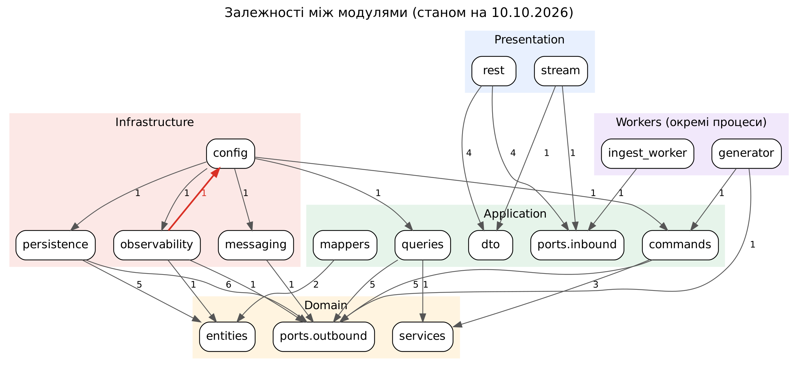
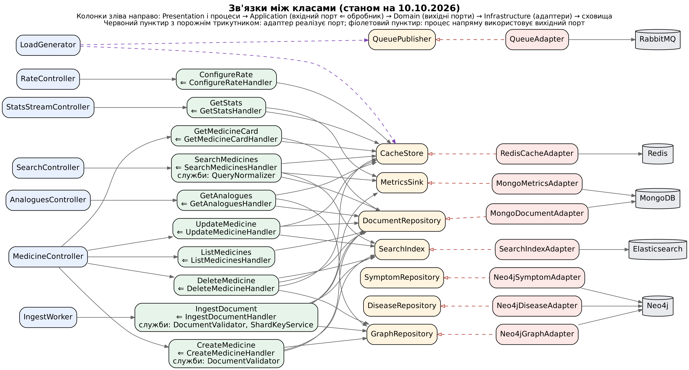

# Архітектура: схеми зв'язків і огляд

Станом на 10.10.2026. Схеми генеруються з коду, а не малюються вручну:

```
python scripts/architecture_diagrams.py --date 10.10.2026
```

Потрібен Graphviz (`dot`). Скрипт створює `modules.*` і `usecases.*` (`.dot`, `.svg`, `.png`) та `checks.txt` у цьому каталозі. Код завершення 1 означає, що знайдено залежність проти правил шарів. Для фінальної схеми проєкту скрипт запускають повторно.

## 3.11. Огляд архітектури та схема зв'язків між класами й модулями

Дата огляду: 10.10.2026. Огляд виконано за поточним станом репозиторію (https://github.com/ArtemHaylo/BD_coursework_medicine): 63 модулі, 82 класи, 10 вхідних і 8 вихідних портів, 10 обробників, 8 адаптерів, 5 контролерів. Схеми побудовано не вручну, а автоматично з вихідного коду скриптом scripts/architecture_diagrams.py (аналіз синтаксичного дерева Python), тому вони відображають фактичні імпорти та залежності конструкторів. Після завершення проєкту скрипт буде запущено повторно, щоб отримати фінальну схему.

### 3.11.1. Залежності між модулями

На рис. 3.7 показано залежності між підпакетами проєкту. Стрілка веде від модуля, який імпортує, до модуля, який імпортується; число на стрілці означає кількість операторів імпорту. Залежності між шарами спрямовані до шару Domain, який не імпортує жодного іншого шару. Presentation залежить лише від Application (DTO та вхідні порти), Infrastructure - лише від Domain (порти та сутності), а модуль config є композиційним коренем і єдиним місцем, що знає всі шари. Єдину залежність проти правила виділено червоним: модуль observability імпортує налаштування з config (зауваження 1 у табл. 3.8).



*Рисунок 3.7 – Залежності між модулями (станом на 10.10.2026)*

### 3.11.2. Зв'язки між класами

Рис. 3.8 зліва направо показує ланцюжок виклику: контролер або процес (генератор, Ingest Worker) → вхідний порт, який реалізує обробник → вихідні порти домену → адаптер, що реалізує порт → сховище. Суцільна стрілка означає «залежить від» (параметр конструктора), червоний пунктир із порожнім трикутником - «реалізує». Обробники залежать лише від інтерфейсів: жоден із них не імпортує клас адаптера, а конкретні адаптери підставляє композиційний корінь Container. Фіолетовий пунктир показує, що генератор напряму використовує вихідні порти CacheStore (читання config:rate) і QueuePublisher (публікація пакетів).



*Рисунок 3.8 – Зв'язки між класами (станом на 10.10.2026)*

Точні залежності кожного обробника наведено в табл. 3.7 (вона уточнює табл. 3.5).

**Таблиця 3.7. Залежності обробників від вихідних портів і доменних служб (станом на 10.10.2026)**

| Вхідний порт | Обробник | Вихідні порти | Доменні служби |
|---|---|---|---|
| SearchMedicines | SearchMedicinesHandler | SearchIndex, CacheStore, DocumentRepository, MetricsSink | QueryNormalizer |
| GetMedicineCard | GetMedicineCardHandler | DocumentRepository, CacheStore | - |
| GetAnalogues | GetAnaloguesHandler | GraphRepository, DocumentRepository, CacheStore | - |
| ListMedicines | ListMedicinesHandler | DocumentRepository | - |
| GetStats | GetStatsHandler | CacheStore, MetricsSink | - |
| IngestDocument | IngestDocumentHandler | DocumentRepository, SearchIndex, GraphRepository, MetricsSink | DocumentValidator, ShardKeyService |
| CreateMedicine | CreateMedicineHandler | DocumentRepository, SearchIndex, GraphRepository | DocumentValidator |
| UpdateMedicine | UpdateMedicineHandler | DocumentRepository, SearchIndex, CacheStore | - |
| DeleteMedicine | DeleteMedicineHandler | DocumentRepository, SearchIndex, GraphRepository, CacheStore | - |
| ConfigureRate | ConfigureRateHandler | CacheStore | - |

### 3.11.3. Результати огляду

Автоматичні перевірки (файл docs/architecture/checks.txt) показали: Domain і Application не імпортують Infrastructure; кожен вихідний порт має адаптер; кожен вхідний порт має обробник і викликається контролером або процесом. Виявлені зауваження наведено в табл. 3.8.

**Таблиця 3.8. Зауваження за результатами огляду (станом на 10.10.2026)**

| № | Зауваження | Рекомендація | Статус |
|---|---|---|---|
| 1 | Циклічна залежність пакетів: logging_config.py (observability) імпортує LoggingSettings із config.settings, а Container із config імпортує observability. | Винести settings.py з config (наприклад, в infrastructure/settings.py) або передавати в setup_logging прості параметри. | Відкрито |
| 2 | Генератор (workers/generator.py) імпортує константу RATE_KEY з модуля обробника ConfigureRateHandler, тобто залежить не лише від портів. | Перенести RATE_KEY в домен (поряд із портом CacheStore) або в налаштування. | Відкрито |
| 3 | UpdateMedicineHandler не залежить від GraphRepository, хоча MedicineUpdateDto дозволяє змінювати uses, side_effects і substitutes, які в Neo4j є ребрами. Після оновлення граф розійдеться з документом. | Додати GraphRepository в обробник (перебудова ребер) або заборонити зміну цих полів у DTO. | Відкрито |
| 4 | DiseaseRepository і SymptomRepository (CRUD довідників) поки не використовує жоден обробник: немає сценаріїв читання хвороб і симптомів. | Додати сценарії ListDiseases / ListSymptoms для UI («від симптому до списку хвороб») або залишити порти як резерв. | Відкрито |
| 5 | Запис у MongoDB, Elasticsearch і Neo4j не є розподіленою транзакцією: при збої одного зі сховищ дані тимчасово розходяться. | Свідомий компроміс (eventual consistency): ідентифікатори детерміновані (UUID5), запис ідемпотентний, повідомлення підтверджується лише після запису в усі сховища. Описати у звіті. | Прийнято |
| 6 | app/main.py та Container.start() поки заглушки, тому зв'язки композиційного кореня зі створенням адаптерів на схемах не відображені. | Додати після реалізації та врахувати у фінальній схемі. | Заплановано |

### 3.11.4. Розбіжності між текстом звіту та кодом

Після додавання CRUD-сценаріїв і довідників частину розділу 3 слід привести у відповідність до коду (табл. 3.9).

**Таблиця 3.9. Місця звіту, що потребують оновлення (станом на 10.10.2026)**

| Місце у звіті | Що написано | Що в коді |
|---|---|---|
| 3.2, табл. 3.2 та текст про порти | 5 вхідних портів | 10: додано ListMedicines, GetStats, CreateMedicine, UpdateMedicine, DeleteMedicine |
| 3.2, вихідні порти | 6 вихідних портів | 8: додано DiseaseRepository, SymptomRepository |
| 3.6.1, табл. 3.5 | 5 обробників | 10 обробників (див. табл. 3.7) |
| 3.9, дерево каталогів | commands - 2 обробники, queries - 3, dto - 3 класи, persistence - 4 адаптери | commands - 5, queries - 5, dto - 16 класів, persistence - 6 адаптерів (додано Neo4jDiseaseAdapter, Neo4jSymptomAdapter); є також application/mappers.py і domain/errors.py |
| 3.9, domain/entities | Medicine, Disease, Symptom | також SearchLogEntry, SearchDocument, SearchHit |
| 1.4, рис. 1.1, табл. 2.4 | сутність «Пошуковий запит» (Search Query) | у коді це SearchLogEntry; SearchQuery - лише DTO вхідного запиту, який не зберігається |

### 3.11.5. Висновки

Архітектура відповідає заявленій у розділі 3: залежності спрямовані до домену, ядро не знає про сховища, шляхи запису й читання розділені. Відкритими лишаються чотири зауваження (1-4), які варто закрити до реалізації адаптерів. Фінальну схему взаємодії елементів системи (з Docker Compose, кластером MongoDB, чергою RabbitMQ і композиційним коренем) буде додано після завершення проєкту повторним запуском скрипта.
